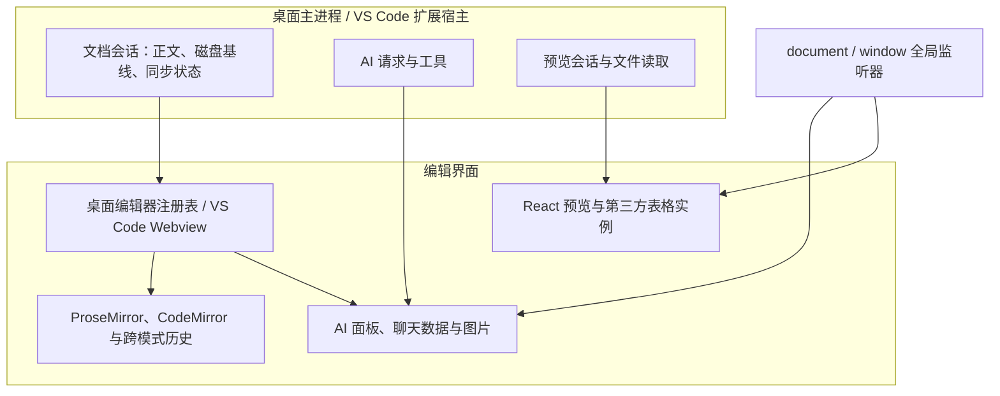

# EasyView_Md 架构与内存效率审查

审查日期：2026-10-17。代码基线：`c4227d246b2b7a50a1fb4b058ebb08f40460300d`。桌面端版本：2.1.2；VS Code 扩展版本：2.1.6。

## 1. 结论

当前最需要处理的是一个多窗口重启的数据丢失风险，以及两个已经复现的资源回收缺陷：**AI 面板销毁后保留全局监听器，表格预览关闭后保留第三方组件及其全局监听器。** 这两个问题能够解释“用得越久、切换得越多，内存越难降下来”的现象。

其次，近期 AI 消息广播会让未打开的后台面板一起初始化；跨模式撤销、聊天会话和部分常驻文档只有条数限制或没有内存预算；Version Guard 批量丢弃操作会并发整读所有目标文件。这些分别带来常驻内存增长和处理峰值。

**审查没有证据证明普通 Markdown 使用一定会占用数 GB，也不能把安装包大小或单次进程内存读数直接当成泄漏证据。** 本报告将实际复现、组件实验和代码推导分开列出。建议先修复释放、请求归属和退出范围，再建立容量预算，最后处理大文件解析与渲染效率。

## 2. 审查范围与证据等级

### 2.1 最近修改的范围

以 2026-10-01 至当前 HEAD 为主要观察窗口，共 81 个提交。对比窗口前基线 `a80e3d3b115c5e45998ba6089c3329d94d757a6f`，共 446 个文件变化，新增 23,297 行、删除 3,226 行；其中应用和共享包的 TypeScript 文件 357 个，新增 17,801 行、删除 2,767 行。统计包含测试、样例和发布文件，不能将其全部理解为运行时代码增长。

重点检查以下变更及其当前调用链：

| 提交 | 日期 | 变更 | 审查关注点 |
| --- | --- | --- | --- |
| `9e017aa` | 10-16 | 统一设置、独立 AI 聊天、面板调整 | 面板所有权、独立会话与文档会话关系 |
| `aa3662f` | 10-16 | 修复 AI 设置保存等待 | 广播是否破坏惰性加载及响应归属 |
| `835e719` | 10-16 | AI 流式 Markdown、面板宽度 | 每次刷新是否重复处理完整回答 |
| `27def46` | 10-16 | Version Guard | Git 并发、批量文件读取、状态与历史缓存 |
| `e76126a` | 10-16 | 面板拖放与停靠 | 编辑器激活、后台面板和销毁边界 |
| `a2d5ae8` | 10-15 | 搜索、欢迎页、双语 UI | 文档与独立聊天的切换行为 |
| `ef42326` | 10-13 | Timeline 与历史保护 | 历史正文驻留、任务预算、Worker 回收 |
| `6b6535e` | 10-12 | 重命名与保存竞态 | 会话绑定、写入序列和保存后的内容归属 |

AI 监听器、表格销毁和跨模式历史中的缺陷早于本次观察窗口存在。下文明确区分“近期新引入”和“当前仍存在、近期使用方式放大”的问题，不能把全部问题归因于最后一次提交。

### 2.2 验证方法

| 等级 | 含义 |
| --- | --- |
| A：实际应用运行验证 | 启动当前源码生产构建的 Electron，经过真实窗口、菜单、标签或预览链路验证 |
| B：当前源码组件实验 | 将当前模块直接打包，在真实 Chromium 或 Node 环境中进行可控输入验证 |
| C：当前代码确认的风险 | 有具体实现和调用链依据，尚未执行相应的大规模或完整用户场景 |

运行环境为 macOS / arm64，Apple M5 Pro、48 GiB 内存；Electron 37.10.3，Chromium 138.0.7204.251；Node v22.17.1。表格依赖为 `x-data-spreadsheet` 1.1.9、ExcelJS 4.4.0。

所有应用实验使用独立临时 `--user-data-dir` 和生成的测试文件，关闭自动更新检查。没有读取真实 AI 密钥或调用外部模型。内存采样前通过 CDP 执行 `HeapProfiler.collectGarbage`；同时读取 DOM 数量、事件监听器和 JS 堆，以区分首次加载、短时分配与持续保留。实验结束后关闭测试进程。

多窗口重启实验拦截 `app.relaunch()`、`app.exit()` 并记录调用，避免真正退出与拉起应用；确认对话框被替换为“取消”应答，以观察是否走到确认步骤。

## 3. 当前架构的主要判断

“两个宿主 + 共享编辑器、同步协议和 Node 服务”的分包方向是合理的。当前架构检查通过，编辑器依赖图 211 个模块，没有循环依赖。问题集中在**资源生命周期的范围、异步请求的归属、容量限制的层级**。



文档的原始文本、规范化文本、编辑器结构和磁盘基线各有用途，不能简单视为应该删除的重复副本。真正的问题是：部分对象销毁后仍由全局监听器持有；部分后台资源没有按大小预算；文档级、窗口级与应用级操作使用了不同的范围。

## 4. 重要问题清单

P0 表示应先处理的数据丢失风险；P1 表示应优先修复的正确性或内存风险；P2 表示有明确价值、可随后实施的效率改进。条件性风险不代表已经发生 OOM。

| 编号 | 优先级 | 问题 | 证据 | 与近期修改关系 |
| --- | --- | --- | --- | --- |
| F01 | P0 | 在干净窗口重启，跳过其他窗口的未保存文档 | A | 多窗口架构下，重启确认范围仍是单窗口 |
| F02 | P1 | AI 面板销毁后残留 `document` 点击监听器 | A + B | 既有缺陷，近期广播和面板使用放大 |
| F03 | P1 | 表格预览只移除 DOM，没有释放组件全局监听器 | A | 既有集成缺陷，当前仍可稳定复现 |
| F04 | P1 | AI 响应广播触发所有编辑器的惰性面板初始化 | A | `aa3662f` 的响应广播与现有 Lazy 面板组合引入 |
| F05 | P1 | AI 编辑没有应用结果确认，切换标签可静默丢弃补丁 | B + C | 既有协议缺口，近期停靠和独立聊天增加触发场景 |
| F06 | P1 | Version Guard 丢弃前并发整读全部文件计算指纹 | B | `27def46` 新增 |
| F07 | P1 | 跨模式历史无限保存完整 Markdown 和 EditorState | B + C | 既有缺陷，多实例和长会话增加总量 |
| F08 | P2 | 编辑器、文档会话与快照缓存缺少按字节的驻留预算 | C | 多文档与多窗口下的总体容量问题 |
| F09 | P2 | AI 消息、推理和图片只限制落盘，不限制当前会话 | B + C | 既有设计，长会话和多面板放大 |
| F10 | P1（大文件条件） | 可编辑表格全量解析，缺少展开规模预算与取消 | C | 当前重型预览处理边界不足 |
| F11 | P2 | AI 每帧重解析完整回答，完成后再重绘整段会话 | B + C | `835e719` 增加流式 Markdown 的解析与 DOM 成本 |

### F01：多窗口重启的确认范围小于退出范围

**根本原因：窗口级检查控制了应用级退出。**

[windowService.ts:149](../../apps/desktop/src/main/application/window/windowService.ts#L149) 的 `restartApp()` 检查当前上下文的 `documentSessions.hasDirty()`，并传入当前窗口的 `confirmCloseAll()`。随后执行的是全局 `app.relaunch()` 和 `app.exit(0)`。

[documentWorkflow.ts:418](../../apps/desktop/src/main/application/document/documentWorkflow.ts#L418) 中的确认流程只遍历当前 `DocumentSessionService`。[windowContext.ts:39](../../apps/desktop/src/main/application/host/windowContext.ts#L39) 为每个窗口创建自己的文档服务。全局退出因此覆盖了未参加确认的其他窗口。

运行复现：窗口 A 修改 `notes.md`，标签状态为 `dirty: true`，磁盘仍是原文；新建干净窗口 B，在 B 的应用菜单点击“重启”。拦截结果：

```text
窗口数：2
保存确认次数：0
relaunch 调用次数：1
exit 调用次数：1
```

这确认了绕过其他窗口未保存内容的路径。实验拦截了退出，没有故意制造真实数据丢失；生产路径会退出整个应用。

**建议：** 应用级重启必须由应用级协调入口管理：遍历所有窗口的文档会话，完成同步与保存/放弃确认；任何窗口取消都终止重启。复用现有窗口保存能力，避免重新实现保存逻辑。单窗口关闭继续使用窗口级确认。

### F02：AI 面板销毁不解除全局点击监听器

[AiChatPanel.ts:910](../../packages/editor-core/src/ui/AiChatPanel.ts#L910) 直接注册匿名 `document.addEventListener('click', ...)`。其回调引用 `modelMenu`、`modeMenu` 等面板节点。[同文件:1523](../../packages/editor-core/src/ui/AiChatPanel.ts#L1523) 的 `destroy()` 只设置销毁标志、中止请求并移除根节点，没有解除这个监听器。

`if (disposed) return` 只能停止回调工作，不能解除 document 对回调及其闭包中节点的持有。桌面端在关闭标签和 LRU 淘汰时真实调用销毁，因此仅让注册表保持 5 个实例不能消除残留。

组件实验：连续创建并销毁 20 个真实 AI 面板，页面内活跃面板 DOM 数为 0。强制 GC 后：

| 指标 | 实验前 | 实验后 |
| --- | ---: | ---: |
| `document` 的 click 监听器 | 0 | 20 |
| DOM 节点总数 | 1,140 | 3,922 |
| JS 事件监听器总数 | 322 | 562 |

实际应用中再验证编辑器淘汰：编辑器和面板均保持 5 个，发生 3 次编辑器淘汰后，document click 监听器由 5 增至 8；强制 GC 后 DOM 从 5,062 增至 7,609。这说明淘汰了注册表条目，资源仍有残留。

**建议：** 让面板拥有明确的监听器生命周期，使用可解除的命名回调或组件自己的 `AbortController`，销毁时统一释放。同时关闭其设置浮层、清理待定定时器。验收依据应为重复创建/销毁后监听器与脱离 DOM 的节点趋于稳定。

### F03：表格预览关闭后，第三方表格实例仍被 window 持有

[SpreadsheetViewer.ts:192](../../packages/preview-ui/src/viewers/SpreadsheetViewer.ts#L192) 的 effect 清理仅断开自有观察器、滚轮处理、清空 ref 和 DOM。它没有释放 `x-data-spreadsheet` 注册的全局事件。

本地安装的依赖源码 [sheet.js:693](../../node_modules/x-data-spreadsheet/src/component/sheet.js#L693) 注册 `window.resize/click/paste/keydown`，回调持有表格实例；[toolbar/index.js:161](../../node_modules/x-data-spreadsheet/src/component/toolbar/index.js#L161) 还注册 resize。当前集成类型 [xSpreadsheetTypes.ts:89](../../packages/preview-ui/src/spreadsheet/xSpreadsheetTypes.ts#L89) 没有定义销毁契约；检查的 1.1.9 组件源码也没有可供当前集成直接使用的完整公开销毁方法。

在实际应用中，使用一份 500 行 × 30 列的生成 XLSX，反复打开、关闭，确认表格 DOM 已从页面移除，再强制 GC：

| 打开并关闭次数 | DOM 节点 | JS 事件监听器 | window resize | window click | window paste | JS 堆使用 / MiB |
| --- | ---: | ---: | ---: | ---: | ---: | ---: |
| 1 | 6,463 | 1,308 | 5 | 1 | 1 | 17.82 |
| 2 | 7,736 | 1,888 | 7 | 2 | 2 | 17.61 |
| 3 | 9,009 | 2,468 | 9 | 3 | 3 | 18.02 |
| 4 | 10,282 | 3,048 | 11 | 4 | 4 | 18.88 |
| 5 | 11,555 | 3,628 | 13 | 5 | 5 | 19.77 |

本组实验在前述 AI 组件实验之后进行，绝对基数包含前面的资源；**相邻表格循环中稳定增加的 1,273 个 DOM 节点、580 个事件监听器，以及新增的全局事件**，才是归因依据。首次加载模块、字体、React 等因素不应算成每次泄漏。

除内存外，旧实例的 resize 回调仍可执行重绘，窗口缩放时的 CPU 工作也会随历史实例增加。

**建议：** 在第三方组件集成边界真正补齐创建/销毁契约。可选择维护具备完整 teardown 的受控适配实现；若库无法支持，应评估以可销毁 iframe 隔离该组件的全局对象。不能用再次清空 DOM 或调用不存在的 `destroy?.()` 作为修复。涉及隔离边界或依赖替换时，需要单独确认实施方案。

### F04：响应广播绕过惰性加载，并缺少统一的面板归属

[DesktopEditorInstanceRegistry.ts:229](../../apps/desktop/src/renderer/DesktopEditorInstanceRegistry.ts#L229) 把全部 `aiChat.*` 响应转发给所有编辑器。[LazyAiChatPanel.ts:80](../../packages/editor-core/src/ui/LazyAiChatPanel.ts#L80) 收到任意 AI 消息就加载并创建面板，创建前没有判断自己是否拥有该请求。

实际应用实验：

| 状态 | 编辑器实例 | AI 面板实例 | 可见 AI 面板 | document click 监听器 |
| --- | ---: | ---: | ---: | ---: |
| 打开 5 个 Markdown，尚未打开 AI | 5 | 0 | 0 | 0 |
| 只点击一次当前文档的 AI 按钮，收到设置回复 | 5 | 5 | 1 | 5 |

广播解决了后台设置响应收不到的问题，但当前组合会初始化所有后台面板，放大 F02 和聊天数据驻留成本。

归属问题还体现在 [AiChatPanel.ts:1460](../../packages/editor-core/src/ui/AiChatPanel.ts#L1460)：`aiChat.imagePicked` 不带请求归属检查，收到它的每个面板都会添加图片。此项是代码确认，未操作真实图片选择对话框做完整复现；不能直接据此声称内存中必然存在多份相同图片字节。

**建议：** 在传输边界维护 `requestId → 面板/文档会话` 的归属，设置读取和选图也遵守同一规则。只向请求拥有者交付响应，惰性面板只因用户打开或确属自己的请求而初始化。不要恢复为仅发送给当前活动标签，否则后台设置保存等待的问题会重新出现。

### F05：AI 编辑成功的定义停留在“消息已发出”

[ai-chat-host.ts:223](../../packages/node-runtime/src/ai/ai-chat-host.ts#L223) 给活动文档提供的 `applyPatches()` 只发送一条消息，没有等待编辑器接受或拒绝。[agent-tools.ts:199](../../packages/node-runtime/src/ai/agent-tools.ts#L199) 随即返回 `changed: patches.length`。

接收端 [AiChatPanel.ts:1390](../../packages/editor-core/src/ui/AiChatPanel.ts#L1390) 要求请求、当前路径、流式消息对象匹配。编辑器失活时，[index.ts:1784](../../packages/editor-core/src/index.ts#L1784) 会将文档上下文设为不可用，并把聊天路径改成空字符串；`setFilePath()` 会恢复另一组消息，原流式消息对象随之失去。

当前源码组件实验，使用相同的有效补丁：

```text
活动文档：applyDocumentEdit 调用 1 次，正文 original → changed。
模拟标签失活并切换聊天路径后：handleMessage 返回 true，
applyDocumentEdit 调用 0 次，正文仍为 original。
```

实验确认了后台补丁被消费但未应用。结合宿主没有结果确认的实现，工具层可能把“没有执行的编辑”报告为成功；没有调用外部模型验证其最终自然语言回答。

**建议：** 文档修改应以稳定 `documentId`、revision/hash 和请求 ID 为边界，交由持有文档会话的应用层提交。收到明确的接受/冲突结果后，工具才能报告成功。面板负责展示结果，不能让当前可见路径决定一个已发起文档操作是否执行。用户切换标签时，应保留原请求归属或明确取消并反馈。

### F06：Version Guard 批量指纹没有约束文件读取并发和单次分配

[version-guard.ts:235](../../packages/node-runtime/src/git/version-guard.ts#L235) 在丢弃前使用 `Promise.all(paths.map(...readFile...))` 读取完整文件并计算 SHA-256；确认后又计算一次。读取不受文件大小预算约束，也没有流式处理或文件读取并发上限。

同文件的 Git 命令限流只限制 Git 子进程，不限制这些 `fs.readFile()`。因此“Git 并发最多 2 个”不能保护此路径。

Node 实验创建 24 个 4 MiB 文件，调用真实 `VersionGuardService`，在确认入口返回取消，不执行任何丢弃：

```text
目标文件数：24
readFile 最大同时在途数：24
确认前累计读取：100,663,296 字节，即 96 MiB
丢弃结果：false
```

这是读取并发与累计字节数，不是实测峰值恰好为 96 MiB。但完整读取可以同时占用多份 Buffer；目标文件越多、越大，主进程峰值越难控制，而且用户取消前已经产生这笔成本。

**建议：** 提取文件内容指纹的单一实现，使用流式哈希和少量固定并发；保留确认前后指纹比对语义。必须同时约束任务并发和单任务缓冲，单纯加一个 Promise 队列但继续整读超大文件仍不充分。

### F07：跨模式历史会无限保留文本和整个 EditorState

[DualModeHistory.ts:35](../../packages/editor-core/src/editor/DualModeHistory.ts#L35) 每次有变化的模式切换都压入 `{ markdown, mode, editorState }`，没有条数、容量或时间限制。[SourceModeController.ts:125](../../packages/editor-core/src/controllers/SourceModeController.ts#L125) 和 [同文件:224](../../packages/editor-core/src/controllers/SourceModeController.ts#L224) 分别传入 ProseMirror、CodeMirror 的实际状态。

保留 EditorState 的意义是精确恢复，但它也使旧文档树、插件状态、当时的原生撤销历史保持可达。原生历史自己的深度设置不能约束这些外部保存的状态根。

组件实验连续记录 250 个不同内容的切换，最终仍有 250 条快照，快照 Markdown 的逻辑字符总数为 25,000,890。这里没有用真实复杂文档构造全部 EditorState；逻辑字符数不能直接换算为实际堆占用，因为字符串和持久化数据结构可能共享存储。

**建议：** 为跨模式历史设置条数与容量预算，成对处理 undo/redo 的淘汰和界面状态。优先收紧这个桥接历史的边界，保留现有原生历史体系。不要再叠加另一套完整文档历史。需要用实际 PM/CM 状态验证淘汰后旧状态可以回收，且预算内的撤销仍正确。

### F08：驻留策略按实例数控制，尚不能形成内存上限

桌面端确实有 [DesktopEditorInstanceRegistry.ts:10](../../apps/desktop/src/renderer/DesktopEditorInstanceRegistry.ts#L10) 的 5 实例保留限制，不能写成“桌面编辑器无限缓存”。但以下对象不受这一条限制完整约束：

| 层级 | 当前行为 | 容量缺口 |
| --- | --- | --- |
| 桌面热编辑器 | 默认保留 5 个；可见分屏不淘汰 | 小文件和大文件同等计数；可见分屏可超过 5 个 |
| 主进程文档会话 | 打开的文档保留正文、磁盘基线、适配器和同步状态 | Renderer 淘汰实例不会自动卸载相应文档会话 |
| 待用快照 | 最多保留 64 个 `documentSnapshot` | 限条数，不限总文本大小；已有实例接收时也会先进入缓存 |
| VS Code Markdown Webview | `retainContextWhenHidden: true` | 隐藏后保留完整编辑界面，没有该项目自行管理的容量策略 |

依据：[documentSession.ts:14](../../apps/desktop/src/main/application/document/documentSession.ts#L14)、[DocumentSessionService.ts:58](../../apps/desktop/src/main/application/document/DocumentSessionService.ts#L58)、[DesktopEditorInstanceRegistry.ts:214](../../apps/desktop/src/renderer/DesktopEditorInstanceRegistry.ts#L214)、[provider.ts:35](../../apps/vscode-extension/src/adapters/vscode/provider.ts#L35)。

这些大多是明确的驻留策略，不能等同于泄漏。当前缺口在于没有把宿主、热编辑器、快照和历史的总容量纳入同一份资源预算。

**建议：** 在现有注册表与会话服务上增加按大小的预算和诊断，优先回收可重建的干净后台资源。未保存正文、同步中的编辑和可见视图必须有明确保护。VS Code 的保持上下文有降低切换卡顿的理由，不宜直接全量关闭该选项；应先量化场景，再决定适用的大文件和后台释放策略。

### F09：聊天限制作用于存储和请求条数，未限制常驻数据

[AiChatPanel.ts:680](../../packages/editor-core/src/ui/AiChatPanel.ts#L680) 的 200 条、每字段 32,000 字符限制，仅作用于序列化到 localStorage 的副本。`messages` 和 `history` 在发送、完成时继续追加；请求只发送最后 40 条，并不会裁剪原数组。`renderMessages()` 遍历所有消息构建 DOM。

组件实验完成 105 轮模拟对话后：界面保留 210 条消息，存储副本为 200 条，证明存储限制不能限制当前会话。

图片的驻留更值得关注：上传和粘贴通过完整 Data URL 保存在待发附件及已发消息中，缺少总大小和图片数量限制。[桌面选图:68](../../apps/desktop/src/main/application/ai/createDesktopAiChatHost.ts#L68)、[扩展选图:63](../../apps/vscode-extension/src/application/ai/createPanelAiChatHost.ts#L63)、[粘贴:1249](../../packages/editor-core/src/ui/AiChatPanel.ts#L1249) 均可看到整读或 `readAsDataURL()` 路径。缩略图的 CSS 尺寸不会降低原始编码数据本身的大小。

**建议：** 分别定义聊天存储、模型上下文、内存消息和可见消息窗口的预算。内存数组应真正裁剪或分页，不能只在 JSON 写入时切片；稳定消息 DOM 应复用。选图时检查输入总量，生成缩略图，明确原图何时释放、何时重新读取；对象 URL 和资源句柄必须随消息移除而释放。

### F10：表格文件的输入大小限制没有覆盖解析后的工作集

[preview.ts:39](../../packages/contracts/src/preview/preview.ts#L39) 允许表格源文件最大 128 MiB。可编辑 XLSX 路径在 [SpreadsheetViewer.ts:100](../../packages/preview-ui/src/viewers/SpreadsheetViewer.ts#L100) 先 `arrayBuffer()`，再完整 `workbookBytesToXsSheets()`，之后才检查是否已经卸载。

[xSpreadsheetBridge.ts:13](../../packages/preview-ui/src/spreadsheet/xSpreadsheetBridge.ts#L13) 在当前 renderer 中构造完整 ExcelJS 工作簿，再转成全部工作表的数据。源字节、工作簿对象和转换结果在处理阶段会同时存活。转换还会逐行逐格处理，并把合并区域的从属坐标逐个放入 Set（[同文件:53](../../packages/preview-ui/src/spreadsheet/xSpreadsheetBridge.ts#L53)）；稀疏表和大合并区域的逻辑展开规模与压缩文件大小不成固定比例。

关闭预览只设置 `disposed`，没有 AbortController 中止 fetch，也无法终止已经开始的解析。第二轮动态 import 后也没有在创建组件前再次检查销毁状态。Word 的加载路径同样存在完整读取和只用标志丢弃结果的行为，但本次确认的主要重型转换链是可编辑 XLSX。

这与 F03 不同：即使最终完全回收，打开大表、连续切换正在加载的文件仍可能产生很高的短时峰值和 UI 停顿。本次未执行接近 128 MiB 的极限表格，也没有实测其 OOM 临界点。

**建议：** 在预览层建立可取消的单次加载任务；fetch 传入取消信号，解析移到可终止 Worker，ArrayBuffer 尽量使用所有权转移。为工作表数、实际单元格数、合并区域面积和展开字节制定预算；先展示当前工作表所需数据，避免无条件展开全部空白区域。Worker 只解决界面线程占用，容量预算仍然必须存在。超出预算应明确告知用户，不能静默截断可编辑数据。

### F11：流式 Markdown 每次重建完整回答，长对话还会反复重建旧消息

[AiChatPanel.ts:838](../../packages/editor-core/src/ui/AiChatPanel.ts#L838) 虽然使用 rAF 合并更新，但每帧仍把完整的累积回答交给 Markdown 解析器、替换 `innerHTML`，再遍历并装饰代码块。[aiChatMarkdown.ts:24](../../packages/editor-core/src/ui/aiChatMarkdown.ts#L24) 还会扫描全文修补未闭合代码围栏。

若长度为 N 的回答分 K 次可见更新，处理的是各次前缀长度之和，量级约为 `O(N × K)`；固定小增量持续到 N 时可表现为二次增长。rAF 限制频率，但没有消除重复工作。工具事件、完成和错误又会触发整个 `messages` 的重绘，与 F09 的无界消息数相互放大。

真实 Chromium 中，对同一结构的 Markdown 连续渲染 5 次，仅计算解析输出 HTML 的平均耗时：10,000 字符约 1.64 ms，50,000 字符约 3.34 ms，100,000 字符约 8.36 ms。该数据不含 DOM 解析、替换、代码块装饰、布局与绘制，也不是完整输入延迟。

**建议：** 先复用已完成消息的 DOM，流式阶段只更新当前消息；对渲染频率设置时间与长度阈值，后台/隐藏面板不做无意义的可视重绘。随后按稳定 Markdown 块缓存解析结果，保留尾部未完成块重解析，避免一开始就引入复杂的全文增量解析系统。必须覆盖围栏、列表、表格等跨块语义。

## 5. 已有措施与其他效率机会

### 5.1 当前已经具备的有效边界

以下措施在当前实现中确实存在，应保留并复用：

- 桌面编辑器有实例 LRU，文档编辑器各自拥有状态；跨文档快照切换时也会清空跨模式历史。不能沿用“所有文档共用一个撤销栈”的旧结论。
- 保存以明确的 session ID 和排队时传入的 content 进行处理，并有文件路径队列。近期修复已经改变了旧的活动全局会话保存模型，相关保存与重命名测试本轮通过。
- 同步层已经识别被外部补丁替代的旧 ACK，并把 retired ID 集合限制为 64 条；不能把之前的 ACK 问题直接当成当前仍复现的问题。
- PreviewShell 按路由动态加载 Viewer。文件预览和历史 Webview 使用 `retainContextWhenHidden: false`，与 Markdown 编辑 Webview 的策略不同。
- 旧 PPT Viewer 的帧缓存有 64 MiB / 48 条上限，并开启虚拟化及延迟释放，清理时调用 mounted/viewer close。
- Timeline 服务采用无全文历史库缓存的查询方式，查询/读取各有并发队列；历史正文读取限制为 32 MiB，diff Worker 有计算预算和超时，并会终止和释放 URL。
- 本地历史会合并同文件待写快照，限制待处理文件数及历史条数；不能归类为“所有保存历史无限留在 JS 内存”。
- Version Guard 的 Git 命令有宿主进程级并发 2 和单命令输出上限；面板失焦/隐藏时停止其活动监听。这些措施没有覆盖 F06 的并发文件整读。

对应实现入口：[EditorSyncAdapter.ts:60](../../packages/editor-core/src/sync/editorSyncAdapter.ts#L60)、[documentSyncSession.ts:106](../../packages/editor-sync/documentSyncSession.ts#L106)、[DocumentSessionService.ts:320](../../apps/desktop/src/main/application/document/DocumentSessionService.ts#L320)、[HistoryView.ts:37](../../packages/editor-core/src/timeline/HistoryView.ts#L37)、[local-history.ts:34](../../packages/node-runtime/src/timeline/local-history.ts#L34)。

### 5.2 优先级较低的机会

| 位置 | 当前情况 | 建议 |
| --- | --- | --- |
| `VersionGuardPanel.ts:315–359` | “更多”累计追加全部历史；`commitFiles` Map 无淘汰；列表整体重建 | 给历史、提交文件缓存加明确容量和列表窗口。先量化大型仓库再设置阈值 |
| `EditorCore.ts:731–771` → `EditorSyncAdapter.applyLocalContent()` | WYSIWYG 在 100 ms 防抖后全文序列化，再求最小文本补丁；源码模式也将全文字符串交给同步适配器 | 后续评估复用 PM/CM 的变更范围；先围绕序列化、补丁计算和哈希分别计时，避免重做同步架构 |
| `documentFileSystem.ts:compareAndWrite()` | 为冲突检测多次整读并计算完整内容哈希 | 大文件可用流式指纹降低额外 Buffer 峰值；保留冲突检测。文件多次读取和原子替换仍不是跨进程事务 |

本轮单独测量当前 `hashContent()`，5,000,000 字符在 Node 中稳定样本约 12.8–14.5 ms，末尾单字符变化的 `minimalTextPatch()` 约 12.6 ms。它们存在全文线性成本，但没有依据把 BigInt 哈希单独定性为当前首要性能瓶颈；更应先处理实测泄漏和重复全量工作。

外部不合作进程仍可能在内容检查与文件替换之间写入，当前文件系统适配器也明确保留这一 OS 层竞争窗口。不能将“方法叫 compareAndWrite”解释为提供了跨进程原子比较交换保证；本轮未重新制造覆盖事故，不将其列为新复现结论。

## 6. 建议的修复顺序与验收

| 顺序 | 工作 | 最小合理范围 | 核心验收 |
| --- | --- | --- | --- |
| 1 | 应用级重启确认 | 应用生命周期入口，复用现有窗口保存能力 | A 脏/B 干净、A 干净/B 脏、两窗口脏；任一窗口取消都不得退出 |
| 2 | AI 面板完整销毁 | AI 面板及其拥有的浮层、事件和任务 | 20 次创建/销毁后，全局监听器不随次数增加；编辑器 LRU 淘汰后旧节点可回收 |
| 3 | 表格组件真实销毁 | 表格第三方集成边界 | 同一 XLSX 打开/关闭 20 次；预热后的事件、DOM、GC 后保留量不线性增加；缩放只作用于活跃实例 |
| 4 | AI 请求与编辑结果归属 | AI 消息协议、宿主路由和文档会话提交 | 一个请求只初始化自己的面板；选图只进入请求面板；后台编辑得到明确成功或拒绝 |
| 5 | 批量文件指纹限流 | Node 文件指纹能力与 Version Guard 调用点 | 24 文件实验并发受限，单文件使用固定缓冲；取消与确认前后冲突检测仍正确 |
| 6 | 跨模式历史与聊天容量 | 既有历史类和聊天数据层 | 长会话达到预算后趋于稳定；预算内撤销正确；聊天存储、请求与展示各有边界 |
| 7 | 文档和预览工作集预算 | 既有注册表、会话服务、预览任务 | 大文件、多后台标签、多窗口可观测；资源淘汰保留未保存内容；关闭能取消加载 |
| 8 | 渲染与增量效率 | AI 稳定消息 DOM、流式尾部、重型解析 | 输入响应、长任务和分配速率改善；格式与编辑语义回归通过 |

修复前先用本报告中的小场景保留基线，不需要搭建庞大的 E2E 系统。每个真实缺陷补一个能证明资源归属或结果确认的回归检查，再进行有限的真实运行循环。

涉及 Worker/iframe 边界、第三方依赖替换、后台文档卸载、AI 文档提交协议的改变，属于需要进一步确认的实施方案。本报告只给出审查结论和修复方向。

## 7. 后续内存验证应如何取数

建议将以下计数接入现有诊断入口，而不是另建一套监控产品：

| 类别 | 建议计数 | 能回答的问题 |
| --- | --- | --- |
| 进程 | 主进程、renderer、GPU 的内存分别记录 | 是文档/UI、宿主 Buffer，还是图像/绘制工作集增长 |
| 文档 | 打开会话、脏会话、热编辑器、可见编辑器、快照估算字节 | LRU 淘汰是否只移除了界面实例 |
| 历史/聊天 | 跨模式快照、消息/推理字符、附件源字节、可见消息数 | 使用时间增长是否伴随无界常驻数据 |
| 预览/任务 | 活跃 Viewer、解析 Worker、正在读取字节、取消数 | 关闭标签后工作是否仍在进行 |
| 生命周期 | 创建/销毁/活动实例、监听器残留、脱离 DOM 的节点 | 是否有对象已经退出注册表却没有释放 |

对比场景应先预热，再按 1/5/10/20 次操作取样；显式 GC 仅用于测试定位，不作为产品正常运行策略。JS 堆、DOM、ArrayBuffer、原生内存和 GPU 内存需要分别看。Electron 多进程可能共享页面，不能把进程工作集简单相加后声称等于独占物理内存。

## 8. 本轮验证结果与复核方式

| 检查 | 结果 |
| --- | --- |
| 工作区初始状态 | 干净 |
| 架构边界检查 | 通过 |
| 编辑器依赖图 | 211 模块，无循环 |
| 桌面生产构建 | 通过，并用于实际应用实验 |
| 相关现有测试 | 9 个测试文件，72 项通过 |
| 实际应用实验 | 多窗口重启范围、表格打开/关闭、后台 AI 初始化、编辑器淘汰 |
| 当前源码组件实验 | AI 面板销毁、105 轮聊天、跨模式历史、后台补丁、流式 Markdown |
| 当前源码 Node 实验 | Version Guard 文件指纹并发、全文哈希和文本补丁计时 |
| 未覆盖 | Windows/Linux 运行、VS Code 实际多 Webview 内存、外部模型完整 Agent 会话、极限大文件与长时间 OOM 阈值 |

现有单元测试通过说明已覆盖行为仍满足断言；这些测试没有覆盖本轮全部资源回收与跨窗口场景，因此不能否定已复现问题。

本轮检查命令：

```bash
npm run check:architecture
npm run check:editor-cycles
node apps/desktop/esbuild.mjs --production

npx vitest run \
  packages/editor-core/src/ui/AiChatPanel.test.ts \
  packages/editor-core/src/editor/DualModeHistory.test.ts \
  apps/desktop/src/renderer/DesktopEditorInstanceRegistry.test.ts \
  packages/editor-sync/tests/documentSyncSession.test.ts \
  apps/desktop/src/main/application/document/DocumentSessionService.test.ts \
  apps/desktop/src/main/application/document/appLifecycle.test.ts

npx vitest run \
  packages/node-runtime/tests/version-guard.test.ts \
  packages/node-runtime/tests/timeline.test.ts \
  packages/preview-ui/tests/spreadsheetBridge.test.ts
```

实际运行实验通过 Playwright Electron API 启动上述构建，以独立配置创建所需窗口、文件和标签；使用 CDP 的 `HeapProfiler.collectGarbage`、`Memory.getDOMCounters`、`Runtime.getHeapUsage`，以及 `getEventListeners(window/document)` 取数。表格实验每轮均等待表格出现、关闭标签、等待表格节点离开页面后采样；AI 淘汰实验始终核对活跃实例数与全局监听器数。

审查结论针对以上 HEAD。代码文件未作修改；本次交付为本报告。
