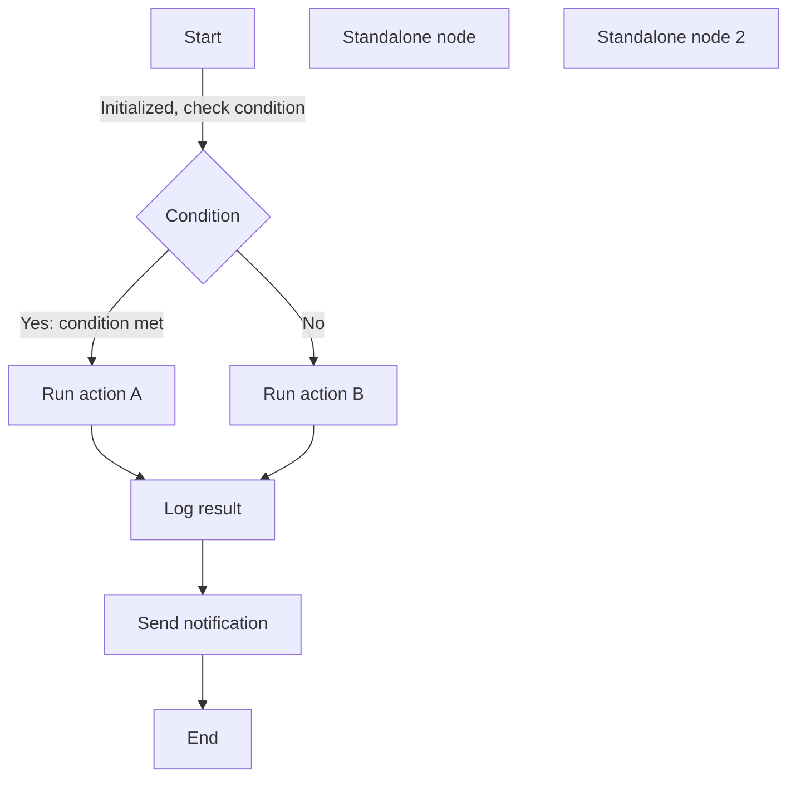
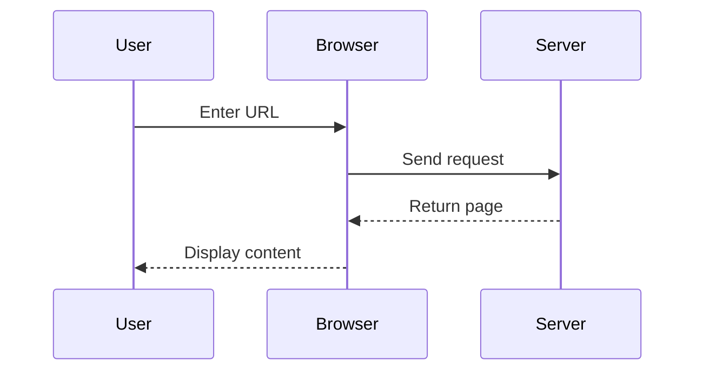
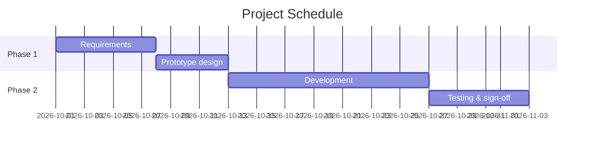

[[_TOC_]]

# EasyView Format Showcase

Welcome to **EasyView**! This document shows the Markdown formats and features EasyView supports.

## Text Formatting

EasyView supports rich text formatting:

- **Bold text** uses `**bold**` or `__bold__`
- *Italic text* uses `*italic*` or `_italic_`
- <u>Underlined text</u> uses `<u>underline</u>`
- ~~Strikethrough text~~ uses `~~strikethrough~~`
- ==Highlighted text== uses `==highlight==`
- `Inline code` is wrapped in backticks

You can also **combine *these formats*** for richer styling.

## Heading Levels

EasyView supports six heading levels, with heading folding, anchor links, and drag-and-drop.

### Level 3 Heading

#### Level 4 Heading

##### Level 5 Heading

###### Level 6 Heading

## Lists

### Unordered List

- First item
- Second item
  - Nested item 2.1
  - Nested item 2.2
    - Deeper nesting 2.2.1
- Third item

### Ordered List

1. Step one
2. Step two
   1. Sub-step 2.1
   2. Sub-step 2.2
3. Step three

### Task List

- [x] Completed task
- [x] Write documentation
- [ ] Pending task
- [ ] Record demo video

### Description List

Term 1

:   This is the definition of term 1

Term 2

:   This is the first definition of term 2

:   This is the second definition of term 2

## Blockquotes

> This is a blockquote.
>
> Blockquotes can contain **formatted text** and multiple paragraphs.
>
> > Blockquotes can also be nested.

## Collapsible Sections

<details>
<summary>Click to expand for more</summary>

This is the content inside the collapsible section. You can put any Markdown here:

- List items
- **Formatted text**
- Code and more

</details>

## Tables

EasyView offers powerful tables: insert, delete, and move rows and columns, merge and split cells, align and sort columns.

<table>
<tr><th align="left"></th><th data-colwidth="100" align="center"></th><th data-colwidth="679" align="center"></th></tr>
<tr><td align="left"></td><td data-colwidth="100" align="center"></td><td data-colwidth="679" align="center"></td></tr>
<tr><td align="left">Feature</td><td data-colwidth="100" align="center">Supported</td><td data-colwidth="679" align="center">Notes</td></tr>
<tr data-easyview-row-height="47"><td align="left">Cell merging</td><td data-easyview-merge-group="evm:1:1:6:2:0:1" data-colwidth="100" align="center">TRUE</td><td data-colwidth="679" align="center">Merge and split</td></tr>
<tr data-easyview-row-height="47"><td align="left">Column alignment</td><td data-easyview-merge-group="evm:1:1:6:2:0:1" data-colwidth="100" align="center">TRUE</td><td data-colwidth="679" align="center">Left, center, right</td></tr>
<tr><td align="left">Row/column operations</td><td data-easyview-merge-group="evm:1:1:6:2:0:1" data-colwidth="100" align="center">TRUE</td><td data-colwidth="679" align="center">Insert, delete, move</td></tr>
<tr><td align="left">Text wrapping</td><td data-easyview-merge-group="evm:1:1:6:2:0:1" data-colwidth="100" align="center">TRUE</td><td data-colwidth="679" align="center">Toggle from the toolbar</td></tr>
<tr><td align="left">CSV export</td><td data-easyview-merge-group="evm:1:1:6:2:0:1" data-colwidth="100" align="center">TRUE</td><td data-colwidth="679" align="center">Custom delimiters</td></tr>
<tr><td align="left">Keyword tags</td><td data-colwidth="100" align="center">N/A</td><td data-colwidth="679" align="center">Special values detected automatically</td></tr>
<tr data-easyview-row-height="461"><td align="left">Nesting</td><td data-colwidth="100" align="center">TRUE</td><td data-colwidth="679" align="center">

<table>
<tr data-easyview-row-height="47"><td></td><td align="left">Cell merging</td><td data-easyview-merge-group="evm:1:1:6:2:0:1" data-colwidth="100" align="center">TRUE</td><td data-colwidth="253" align="right">Merge and split</td></tr>
<tr><td></td><td align="left">Column alignment</td><td data-easyview-merge-group="evm:1:1:6:2:0:1" data-colwidth="100" align="center">TRUE</td><td data-colwidth="253" align="right">Left, center, right</td></tr>
<tr><td></td><td align="left">Row/column operations</td><td data-easyview-merge-group="evm:1:1:6:2:0:1" data-colwidth="100" align="center">TRUE</td><td data-colwidth="253" align="right">Insert, delete, move</td></tr>
<tr><td></td><td align="left">Text wrapping</td><td data-easyview-merge-group="evm:1:1:6:2:0:1" data-colwidth="100" align="center">TRUE</td><td data-colwidth="253" align="right">Toggle from the toolbar</td></tr>
<tr><td></td><td align="left">CSV export</td><td data-easyview-merge-group="evm:1:1:6:2:0:1" data-colwidth="100" align="center">TRUE</td><td data-colwidth="253" align="right">Custom delimiters</td></tr>
<tr><td></td><td align="left">Keyword tags</td><td data-colwidth="100" align="center">N/A</td><td data-colwidth="253" align="right">Special values detected automatically</td></tr>
</table></td></tr>
</table>

Keyword tag examples:

| Status | Value | Boolean | Other |
| ----- | ---- | --- | --- |
| TRUE  | NULL | Yes | N/A |
| FALSE | 0    | No  | \-  |

## Horizontal Rules

Use three or more hyphens, asterisks, or underscores to create a horizontal rule:

---

## Code Blocks

EasyView supports syntax highlighting for 70+ languages, line numbers, and one-click copy:

```python
def hello_world():
    """A simple Python function"""
    print("Hello, world!")
    return True

if __name__ == "__main__":
    hello_world()
```

```javascript
// JavaScript example
function fibonacci(n) {
  if (n <= 1) return n;
  return fibonacci(n - 1) + fibonacci(n - 2);
}

console.log(fibonacci(10));
```

```sql
-- SQL query example
SELECT 
    users.name,
    COUNT(orders.id) as order_count
FROM users
LEFT JOIN orders ON users.id = orders.user_id
GROUP BY users.name
HAVING order_count > 5
ORDER BY order_count DESC;
```

## Diagrams

EasyView supports Mermaid diagrams and can export them as images:



Sequence diagram example:



Gantt chart example:



## Math

EasyView renders math with KaTeX.

### Inline Math

Einstein's mass–energy equation: $E = mc^2$

Pythagorean theorem: $a^2 + b^2 = c^2$

### Math Blocks

$$
\int_0^\infty e^{-x^2} dx = \frac{\sqrt{\pi}}{2}
$$

Matrix notation:

$$
\begin{bmatrix}
a & b \\
c & d
\end{bmatrix}
\begin{bmatrix}
x \\
y
\end{bmatrix}
=
\begin{bmatrix}
ax + by \\
cx + dy
\end{bmatrix}
$$

Fourier transform:

$$
F(\omega) = \int_{-\infty}^{\infty} f(t) e^{-i\omega t} dt
$$

## Callouts

EasyView supports five callout styles:

> [!note]
> This is a note callout. Use it for supplementary details and references.

> [!tip]
> This is a tip callout. Use it to share helpful hints and advice.

> [!important]
> This is an important callout. Use it to emphasize key information.

> [!caution]
> This is a caution callout. Use it to flag potential problems.

> [!warning]
> This is a warning callout. Use it for content that needs special attention.

## Links

### Regular Links

Visit the [EasyView GitHub repository](https://github.com/tiantianmanmanzou/EasyView_Md) to learn more.

### Autolinks

[https://github.com/tiantianmanmanzou/EasyView_Md](https://github.com/tiantianmanmanzou/EasyView_Md)

### Anchor Links

Jump to the [Text Formatting](#text-formatting) section.

## Footnotes

EasyView supports footnotes[^1], so you can add references and notes to your documents[^2].

## Images

You can insert images in several ways:

1. Drag from the file system
2. Paste from the clipboard
3. Reference by URL
4. Use the file picker

The image toolbar lets you view full size, resize, and more. EasyView supports PNG, JPEG, GIF, SVG, WebP, BMP, ICO, and other formats.

## HTML Content

EasyView lets you embed HTML blocks:

<div style="padding: 1em; background: linear-gradient(135deg, #667eea 0%, #764ba2 100%); color: white; border-radius: 8px; text-align: center;">
  <h3 style="margin: 0;">Custom-styled HTML block</h3>
  <p style="margin: 0.5em 0 0 0;">Use HTML to create special visual effects</p>
</div>

<!-- This is an HTML comment and is not shown when rendered -->

## Emoji Support

EasyView supports emoji: 😀 🎉 ⭐ 💻 📝 🚀 ✨ 🎨 🔥 💡

## Supported Non-Markdown File Types

Beyond Markdown editing, EasyView can preview and work with many file formats:

### Text Files

- Plain text (`.txt`, `.log`)
- Config files (`.json`, `.jsonc`, `.yaml`, `.yml`, `.xml`, `.ini`, `.conf`, `.properties`, `.toml`)
- Tabular data (`.csv`, `.tsv`)

### Image Files

- Common formats: PNG, JPEG, GIF, WebP, BMP, ICO, TIFF
- Vector: SVG
- macOS icons: ICNS

### Documents

- HTML (`.html`, `.htm`)
- PDF (`.pdf`)

### Microsoft Office Files

- Word: `.docx`, `.docm`, `.dotx`, `.dotm`, `.doc`
- Excel: `.xlsx`, `.xlsm`, `.xlsb`, `.xls`, `.ods`
- PowerPoint: `.pptx`, `.pptm`, `.potx`, `.potm`, `.ppsx`, `.ppsm`, `.ppt`

### Archives

- ZIP, JAR, WAR, EAR, VSIX, APK, CBZ
- TAR, TAR.GZ, TGZ, GZ
- 7Z, RAR, CBR

### Other Formats

- Mind maps: `.xmind`

### File Conversion

EasyView can also convert Word and PDF files to Markdown:

1. Right-click a `.docx`, `.doc`, or `.pdf` file in the file explorer
2. Choose **Convert to Markdown with EasyView_Md**
3. A Markdown file and the extracted images are generated automatically

## Export

EasyView exports to several formats:

- **HTML**: standalone HTML file with dark and light themes
- **PDF**: built-in CJK fonts, with code highlighting and diagrams
- **DOCX**: Microsoft Word format that keeps heading styles and formatting
- **CSV**: export from tables with custom delimiters

---

**Tip**: Press `Ctrl+/` (macOS: `Option+Q`) to switch to source mode and view the raw Markdown.

**About this document**: This showcase covers EasyView's main features and supported formats. Type `/` on an empty line to open the slash menu and quickly insert any of 30+ block types.

**Final words**: A good writing tool should let you focus on the content, not the formatting. Whether you are capturing ideas, writing up meeting notes, or drafting a technical design, EasyView aims to be a tool that feels right at hand. Try out the different block types and export formats in your daily work, and feel free to share your thoughts and suggestions anytime.

[^1]: This is the content of the first footnote.

[^2]: This is the second footnote. It can include **formatted text** and a [link](https://example.com).

<!-- easyview:table-meta {"version":1,"tables":[{"shape":[3,3,3,3,3,3,3,3,3,3],"cells":[{"row":0,"cell":1,"colwidth":[100]},{"row":0,"cell":2,"colwidth":[679]},{"row":1,"cell":1,"colwidth":[100]},{"row":1,"cell":2,"colwidth":[679]},{"row":2,"cell":1,"colwidth":[100]},{"row":2,"cell":2,"colwidth":[679]},{"row":3,"cell":1,"colwidth":[100]},{"row":3,"cell":2,"colwidth":[679]},{"row":4,"cell":1,"colwidth":[100]},{"row":4,"cell":2,"colwidth":[679]},{"row":5,"cell":1,"colwidth":[100]},{"row":5,"cell":2,"colwidth":[679]},{"row":6,"cell":1,"colwidth":[100]},{"row":6,"cell":2,"colwidth":[679]},{"row":7,"cell":1,"colwidth":[100]},{"row":7,"cell":2,"colwidth":[679]},{"row":8,"cell":1,"colwidth":[100]},{"row":8,"cell":2,"colwidth":[679]},{"row":9,"cell":1,"colwidth":[100]},{"row":9,"cell":2,"colwidth":[679]}],"colWidths":[0,100,679],"rowHeights":[0,0,0,47,47,0,0,0,0,461]},{"shape":[4,4,4,4,4,4],"cells":[{"row":0,"cell":2,"colwidth":[100]},{"row":0,"cell":3,"colwidth":[253]},{"row":1,"cell":2,"colwidth":[100]},{"row":1,"cell":3,"colwidth":[253]},{"row":2,"cell":2,"colwidth":[100]},{"row":2,"cell":3,"colwidth":[253]},{"row":3,"cell":2,"colwidth":[100]},{"row":3,"cell":3,"colwidth":[253]},{"row":4,"cell":2,"colwidth":[100]},{"row":4,"cell":3,"colwidth":[253]},{"row":5,"cell":2,"colwidth":[100]},{"row":5,"cell":3,"colwidth":[253]}],"colWidths":[0,0,100,253],"rowHeights":[47,0,0,0,0,0]}]} -->
